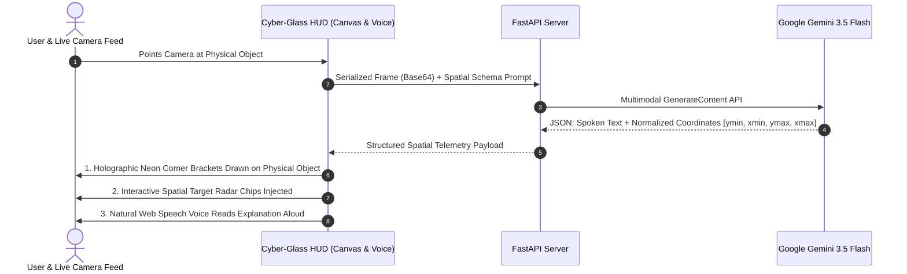

# 👁️ OmniVision Astra
### *Real-Time Spatial Multimodal AR Vision & Voice Assistant (Google Project Astra Class)*

[](https://python.org)
[](https://fastapi.tiangolo.com)
[](https://ai.google.dev/)
[]()
[]()
[](LICENSE)

**OmniVision Astra** is a real-time, browser-native multimodal AI camera assistant inspired by **Google Project Astra**. It keeps a live webcam feed active, perceives real-world physical objects, segments internal and visible components, anchors holographic 2D augmented reality (AR) target reticles directly onto items, and speaks conversational explanations aloud with bidirectional voice telemetry.

---

## 🌟 Architecture & Data Flow



---

## 🚀 Key Capabilities

- 🎯 **Spatial Target Grounding**: Extracts normalized 2D coordinates `[ymin, xmin, ymax, xmax]` on a 0–1000 matrix and projects holographic neon brackets directly onto physical components.
- ⚡ **Sub-Second Latency**: Powered by Google DeepMind's active **Gemini 3.5 Flash**, achieving rapid visual perception and structured JSON telemetry.
- 🗣️ **Bidirectional Voice Loop**:
  - **Speech-to-Text (STT)**: Hands-free voice queries via browser Web Speech API.
  - **Text-to-Speech (TTS)**: Instant natural voice narration with animated audio spectrum waves and instant replay capability.
- 🥽 **Cyber-Glass Aerospace HUD**: 60 FPS HTML5 Canvas engine featuring animated laser scanner sweeps, chamfered corner brackets, gyroscopic 3D AI neural core, and real-time status chips.
- 📊 **Spatial Target Radar**: Interactive color-matched entity badges corresponding to each bounding box. Clicking any badge reads that specific component's function aloud.
- 🔄 **Autonomous Auto-Inspection**: Continuous hands-free auto-scan stream every 4 seconds, ideal for lab benches, hardware inspection, and live portfolio demonstrations.
- 🔬 **Specialized Modes**:
  - **🎯 ALL-SIGHT**: Universal object identification, anatomy segmentation, and usage guide.
  - **🔬 HARDWARE**: Tracing microcontrollers, integrated circuits, pinouts, and PCB solder joints.
  - **💊 MEDICINE**: Formulations, chemical compounds, usage directions, and safety warnings.
  - **📐 MATH & DOCS**: Real-time equation solving, document OCR translation, and textbook formulas.

---

## 🛠️ Tech Stack

- **Backend**: Python 3.11+, FastAPI, Uvicorn, HTTPX, Pydantic v2
- **AI Core**: Google Gemini 3.5 Flash Multimodal Vision API (`google-genai` / REST)
- **Frontend**: HTML5 Canvas, Vanilla ES6+, TailwindCSS, Web Speech API, Web Audio API
- **Design System**: Orbitron, JetBrains Mono, Plus Jakarta Sans, Frosted Glassmorphism

---

## ⚡ Quickstart

### 1. Clone the Repository
```bash
git clone https://github.com/<your-username>/omnivision-copilot.git
cd omnivision-copilot
```

### 2. Set Up Virtual Environment & Dependencies
```bash
# Create and activate virtual environment
python -m venv venv
.\venv\Scripts\activate   # On Linux/macOS: source venv/bin/activate

# Install dependencies
pip install -r requirements.txt
```

### 3. Add Gemini API Key
Create a `.env` file in the project root:
```env
GEMINI_API_KEY=your_gemini_api_key_here
MODEL_NAME=gemini-3.5-flash
PORT=8080
```
> *(Get your free API key at [Google AI Studio](https://aistudio.google.com/)).*

### 4. Run the Application
```bash
uvicorn app.main:app --port 8080 --reload
```
Open **[http://localhost:8080](http://localhost:8080)** in Google Chrome or Microsoft Edge.

---

## 💼 Resume & LinkedIn Highlights

> **OmniVision Astra | Real-Time Multimodal AR Vision & Voice Assistant**  
> *(Python, FastAPI, Google Gemini 3.5 Flash, HTML5 Canvas AR, Web Speech API, Web Audio API)*
> - Architected a real-time multimodal vision system inspired by Google Project Astra, enabling physical object perception and bidirectional voice conversation over live webcam feeds.
> - Implemented an HTML5 Canvas spatial AR renderer that maps Gemini 3.5 Flash's normalized `[ymin, xmin, ymax, xmax]` coordinates to mirror-corrected video frames at 60 FPS.
> - Built a FastAPI backend handling base64 frame serialization and structured JSON telemetry, delivering end-to-end spatial diagnostics with sub-second latency.
> - Engineered a Cyber-Glass HUD dashboard featuring a gyroscopic 3D AI neural core, real-time spatial target radar, and hands-free autonomous streaming.

---

## 📜 License
Distributed under the MIT License.
